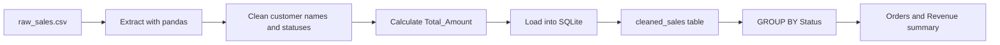

<div align="center">

# Automated Sales ETL Pipeline

### A compact Python + SQL workflow for turning raw sales records into usable business summaries

[](https://www.python.org/)
[](https://pandas.pydata.org/)
[](https://www.sqlite.org/)

**Extract → Transform → Load → Analyze**

</div>

---

## Project overview

This project demonstrates a practical sales-data pipeline built with Python, pandas, SQLite, and SQL. It reads raw transaction records from a CSV file, cleans inconsistent fields, derives a total amount for every order, stores the cleaned records in a SQLite table, and runs an aggregation query to summarize orders and revenue by status.

The goal is deliberately focused: show the complete path from messy input data to a queryable analytical result in a small, understandable project.

## Pipeline flow



## What the pipeline does

### 1. Extract

`pipeline.py` reads the raw CSV transaction file with `pandas.read_csv()`.

### 2. Transform

The transformation step applies three rules:

- Missing `Customer_Name` values become `Unknown`.
- `Status` values are trimmed and converted to a consistent capitalized format.
- `Total_Amount` is derived as `Quantity × Price_Per_Unit`.

### 3. Load

The cleaned DataFrame is written to a local SQLite database named `sales_data.db` in a table called `cleaned_sales`. Existing data in that table is replaced on each run so the example remains reproducible.

### 4. Analyze

The pipeline runs a SQL aggregation grouped by `Status`:

```sql
SELECT
    Status,
    COUNT(Order_ID) AS Total_Orders,
    SUM(Total_Amount) AS Revenue
FROM cleaned_sales
GROUP BY Status;
```

## Input data

The sample file contains these fields:

- `Order_ID` — unique order identifier
- `Customer_Name` — customer name, including one missing example for cleaning
- `Quantity` — number of units in the order
- `Price_Per_Unit` — price of one unit
- `Status` — order state such as delivered, shipped, pending, or cancelled

## Verified sample output

Running the current sample data produces this summary:

```text
--- Sales Summary by Status ---
      Status  Total_Orders  Revenue
0  Cancelled             1      1600
1  Delivered             2      1750
2    Pending             1       900
3    Shipped             1      1200
```

The pipeline also creates `sales_data.db` locally. The generated database is an execution artifact and should not be committed as source data.

## Repository structure

The repository currently keeps the source artifacts in their existing folders:

```text
sales-pipeline/
├── pipeline.py/
│   └── pipeline.py       # ETL and SQL analysis script
├── raw_sales.csv/
│   └── raw_sales.csv     # Sample raw sales data
├── ReadMe.md/
│   └── ReadME.md         # Original project notes
├── README.md             # Project documentation
└── .DS_Store             # Local metadata file
```

## Run the pipeline

### Requirements

- Python 3.9 or newer
- pandas
- Python's built-in `sqlite3` module

Install pandas if needed:

```bash
python3 -m pip install pandas
```

### Execute

Because the current source files are stored in folders named `pipeline.py` and `raw_sales.csv`, run the script from the data folder so its relative CSV path resolves correctly:

```bash
cd raw_sales.csv
python3 ../pipeline.py/pipeline.py
```

Expected final message:

```text
ETL Pipeline Execution Complete!
```

To inspect the generated SQLite table after execution:

```bash
sqlite3 sales_data.db "SELECT * FROM cleaned_sales;"
```

## Technical takeaways

This project demonstrates the foundations of a repeatable data workflow:

- Reading structured files with pandas
- Handling missing and inconsistent values
- Creating derived business metrics
- Loading a DataFrame into a relational table
- Using SQL `GROUP BY`, `COUNT`, and `SUM`
- Producing a business-facing summary from transactional data

## Next improvements

The pipeline can be extended with validation and production-oriented features such as:

- Command-line input and output paths
- Schema and data-quality checks
- A separate configuration file
- Logging and failure handling
- Date-based sales analysis
- Parameterized reporting queries
- Tests for transformations and expected totals

## Author

**G. Rohith Reddy** — aspiring data engineer and CSE–AI student.

- GitHub: [RohithReddy17G](https://github.com/RohithReddy17G)
- Portfolio repository: [rohith-portfolio](https://github.com/RohithReddy17G/rohith-portfolio)
- LinkedIn: [Gunda Rohith Reddy](https://www.linkedin.com/in/gunda-rohith-reddy-234a17359/)
- Email: [gundarohithreddy@gmail.com](mailto:gundarohithreddy@gmail.com)

---

<div align="center">
  <sub>Built to make the path from raw records to useful answers easy to follow.</sub>
</div>
